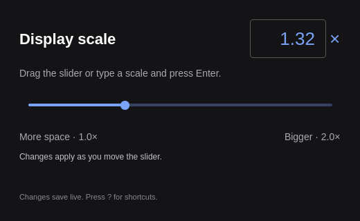

A small Omarchy desktop app for adjusting display scale from 1.00× to 2.00×.
Drag the slider, scroll over it, or type an exact value into the scale field.
Press Enter or leave the field to apply a typed value; Escape cancels editing.
Values use steps of 0.01. Closing keeps the last applied scale.

```sh
./bin/build
./build/scale-slider open
```

`./bin/install` builds and installs the Arch package and launcher entry.
Build requirements: Qt 6 base and declarative, qmake6, make and a C++17 compiler.
The app uses Hyprland's Lua configuration and `hyprctl`.

Each update atomically saves `~/.config/hypr/monitors.lua`, ensures
`debug.disable_scale_checks = true`, and runs `hyprctl reload` followed by
`hyprctl configerrors`. The first update in a session saves a timestamped
backup alongside the file. Rejected updates restore the previous contents.
Updates are throttled to 120 ms while dragging and flushed on release.
The app reads the latest contents before each write, preserving unrelated edits.
Earlier duplicate scale assignments are commented out; one active declaration
remains. The variable must be a simple top-level assignment used by your monitor
rule. Explicit monitor rules with independent scales are not changed.
Block comments and long strings require manual review rather than guessed edits.

The window follows Omarchy's accent, corner rounding and selected language.
English and Danish UI catalogs are included; other languages fall back to English.

| Key | Action |
|---|---|
| Left / Right | Adjust focused slider by 0.01 |
| Scroll over slider | Adjust by 0.01 |
| Enter in scale field | Apply typed scale |
| Escape in scale field | Cancel editing |
| Space | Focus slider |
| Ctrl+Z / Ctrl+Shift+Z | Undo / redo applied changes |
| ? | Show shortcuts |
| Q | Close |

Headless commands:

```sh
scale-slider check --json
scale-slider set 1.45 --json
scale-slider skill install
```

`--config PATH` and `--hyprctl PATH` support isolated testing. `check` inspects
whether the file is editable; it does not change it. `set` validates and applies
one scale. Commands return 0 for success and 1 for errors.

Run `./bin/test` for file preservation, backups, rollback, duplicate declarations,
input validation, and actual QML keyboard, wheel and text-field interaction tests.
Tests use temporary files and a fake compositor command.

Theme and language helpers are adapted from the Omarchy app templates, based on
Omacut by David Heinemeier Hansson (MIT).
